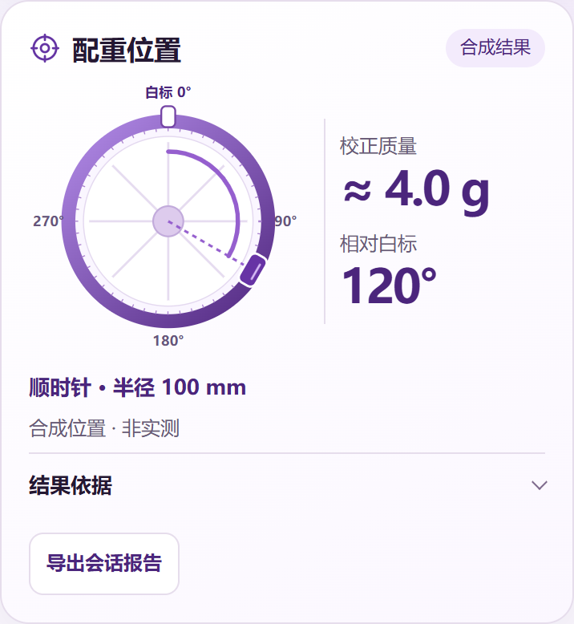

# ESP32-S3 车轮动平衡仪

0.6.13 单平面动平衡原型，面向自行车、电动车和摩托车的装车测量。自行车车轮架空后可手拨滑行。系统以光电白标作为每圈的角度基准，**从 MPU6050 采集的振动数据中提取与车轮转动同频的 1× 分量，并在原轮和试重记录之间匹配相近的转速，减小手拨力度和起始转速不同对比较的影响**。单平面影响系数法用于估算校正质量和相对白标的贴装角度。手机直连设备热点，可查看三轴波形、配重位置与同速复测对比，并导出 CSV 原始数据和 JSON 测量报告。

## 0.6.13 更新

- 电动车模式检测到匀速后自动计时，自行车模式记录自然滑行。原轮、试重和复测使用可比转速的数据。
- 填写每片配重的质量，设备自动决定试重块数与采集时长。检测到试重响应偏弱或候选有分歧时，保留原轮记录并按数据给出下一组试重建议。
- MPU6050 手机测量模式默认使用 44 Hz 硬件低通，姿态诊断可独立启用。电脑回放可按实录转速核对匀速数据。

## 配重界面与装车试测

*配重位置界面。图中克数和角度为合成演示数据。*

*自行车后轮装车试测。白标用于光电定相，传感器固定在靠近后轮的车架上。*

查看更多试测照片

*面包板调试阶段的采集电路。*

*自行车装车试测记录。*

*试测现场的自行车和维修架。*

*后轮一侧的传感器固定与走线。*

## 试测进度

已在自行车和一辆电动车上进行装车试测。该电动车在约 553 RPM 下采用同一个校正块位置，两次复测的同速 1× 振动比原轮分别下降 69.6% 和 68.6%，两次剩余振动幅值相差 3.2%。这一结果对应本次装车条件与转速。跨次估算克数和跨车型的精度仍待验证。

## 接线

开发板为 Seeed XIAO ESP32-S3 Sense（8 MB Flash、8 MB PSRAM）。MPU6050 和 TCRT5000 均使用 3.3 V 供电并和开发板共地。

| 模块 | 信号 | XIAO |
| --- | --- | --- |
| MPU6050 | SDA | D4 / GPIO5 |
| MPU6050 | SCL | D5 / GPIO6 |
| MPU6050 | AD0 | GND |
| TCRT5000 | DO | D0 / GPIO1 |

固件通过 I²C 轮询读取 MPU6050 FIFO，INT 可留空。TCRT5000 的 AO 留空，白标对应 DO 低电平。

## 构建和使用

安装 ESP-IDF 5.5.5 后，在 ESP-IDF 终端进入以下目录。首次刷机前，在菜单的 **Phone diagnostic web server** 中设置自己的热点名称和密码。仓库提供的演示配置为 **WheelBalance-S3** 和 **wheelbalance-demo**。

~~~sh
cd firmware
idf.py menuconfig
idf.py build
idf.py -p PORT flash monitor
~~~

把 PORT 替换为开发板的串口。烧录后手机连接设备热点，打开 http://192.168.4.1。

### 测量流程

**原轮测量 → 加已知试重并测量 → 车轮停稳后取下试重 → 按图贴校正块 → 同速复测**

试重半径与校正半径都从轮轴中心量到对应配重块的中心，单位 mm。

试重仅用于车轮可靠架空、贴块牢靠的受控低速测试。固件会在数据不足或候选配重分歧时保留结果报告。实轮克数重复性和配重精度仍待验证。

## 软件验证

安装 Python 和 Zig，把 zig 加入 PATH，在仓库根目录运行。

~~~sh
python tests/balance_core/run_tests.py --sanitize
python tests/product_session/run_tests.py --assessment --sanitize
python tests/product_session/run_tests.py --retest --sanitize
python tests/product_session/test_window_end_to_end.py
~~~

这些测试覆盖复数影响系数、候选一致性、复测状态和合成 FIFO 数据到配重结果的端到端流程。

## 外壳

hardware 目录含 TCRT5000 和 MPU6050 的 OpenSCAD 外壳模型。打印前按实际模块尺寸检查装配。

## 版本与交流

当前发布版为 [0.6.13](https://github.com/993752488-maker/wheel-balance-esp32s3/releases/tag/v0.6.13)。欢迎在 [Issues](https://github.com/993752488-maker/wheel-balance-esp32s3/issues) 留言，分享轮组类型、试测条件和建议。
